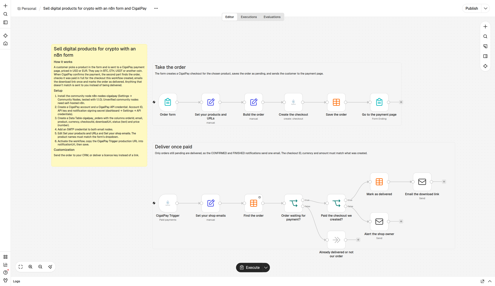

# n8n-nodes-cigalpay

[n8n](https://n8n.io) community nodes for [CigalPay](https://cigalpay.com): accept crypto payments (BTC, ETH, USDT, LTC, SOL, TRX, DOGE and more, plus other coins converted at payment) in your workflows.

- **CigalPay**: create a checkout and get the payment link, read payments, refund, list coins.
- **CigalPay Trigger**: start a workflow when a payment is made, from CigalPay's signed notifications.

## Installation

In n8n: **Settings → Community Nodes → Install**, enter `n8n-nodes-cigalpay`.

Self-hosted with npm: `npm install n8n-nodes-cigalpay` in `~/.n8n/nodes`, then restart n8n.

## Credentials

Create a **CigalPay API** credential with the values from the CigalPay dashboard, **Settings → API credentials**:

| Field | Used for |
|---|---|
| Account ID | Creating checkouts |
| API Key | Reading payments and refunds. Shown once when you create it. |
| Notification Signing Secret | The CigalPay Trigger: checking that notifications come from CigalPay |

## CigalPay node

| Resource | Operation | What it does |
|---|---|---|
| Checkout | Create | Payment priced in USD or EUR (up to 5,000). Returns the `chargeLink` to send your customer to. |
| Payment | Get | One payment by its ID |
| Payment | Get by Order | Every payment created for one of your order references |
| Payment | Get Active | Payments still waiting for funds |
| Refund | Create | Refund a paid payment, in the checkout currency or in the coin paid. The customer gets a link to enter their address. |
| Refund | Get Many | The refunds of a payment |
| Coin | Get Accepted / Get Converted | Coins accepted directly, and coins converted at payment |

## CigalPay Trigger

1. Add a **CigalPay Trigger** and activate the workflow.
2. Use its **production URL** as the **Notification URL** when you create a checkout (with the CigalPay node or the API).
3. CigalPay sends a notification each time the payment's status changes. The trigger checks the `x-cigalpay-sig` signature and refuses anything unsigned or forged with a 401, before the workflow runs.

**Trigger On**: paid payments only (`CONFIRMED` or `FINISHED`, the default), all status changes, or the statuses you pick. Each item has the notification fields plus `isPaid` and `receivedAt`.

To try it, send a sample from the dashboard: **Settings → API credentials → Test notification**. Turn on **Ignore Test Notifications** once you're live.

### Before delivering an order

Anyone can create a checkout with your Account ID and an order reference. Before delivering, check that the notification matches the order you priced:

- `extraId` is your order ID,
- `checkoutAmount` and `checkoutCurrency` are the price you set,
- `isPaid` is `true`.

## Example workflow: sell digital products for crypto

[`examples/sell-digital-product-crypto.json`](examples/sell-digital-product-crypto.json): download it, then in n8n open a new workflow and paste it (or **⋯ → Import from File**).

1. **Take the order:** an n8n form creates a CigalPay checkout for the chosen product, saves the order in a Data Table and sends the customer to the payment page.
2. **Deliver once paid:** the CigalPay Trigger finds the order, checks the checkout ID, currency and amount, emails the download link once and marks the order delivered. Anything that doesn't match is sent to you instead.

Setup steps are in the yellow note on the canvas.

## Limits

- 5,000 USD or EUR per payment.
- One-time payments: no automatic renewals.

## Links

- [Developer documentation](https://cigalpay.com/developers)
- [API reference](https://core-api.cigalpay.com/docs)
- Support: support@cigalpay.com

## License

[MIT](LICENSE)
